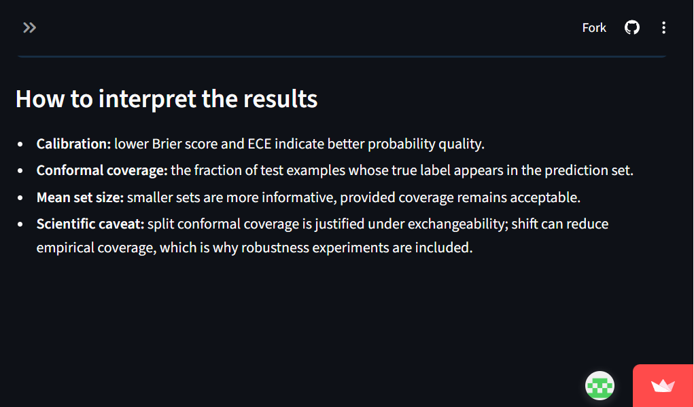
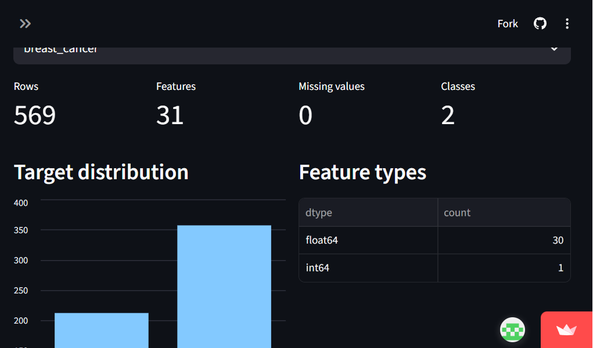

# Medical Uncertainty Benchmark

[](https://www.python.org/)
[](https://bio-ai-uncertainty-benchmark.streamlit.app/)
[](https://scikit-learn.org/)
[](https://github.com/manikanta-pasupuleti/bio-ai-uncertainty-benchmark)

**Robustness and uncertainty quantification for small-data biomedical classification.**

This capstone project studies whether calibrated probabilities and split conformal
prediction sets remain useful when biomedical datasets are small, noisy, or affected
by distribution shift.

## Live demo

Open the deployed Streamlit application:

**[bio-ai-uncertainty-benchmark.streamlit.app](https://bio-ai-uncertainty-benchmark.streamlit.app/)**

The dashboard includes:

- Dataset Explorer for sample size, feature structure, missingness, and class balance
- Benchmark Results for accuracy, Brier score, ECE, coverage, and prediction-set size
- Robustness Analysis for feature noise and covariate-shift experiments
- Prediction Demo for inspecting individual uncertainty outputs

## Screenshots

### Capstone dashboard



### Dataset Explorer



## Research question

> When biomedical datasets are small, noisy, or shifted, how reliably do calibrated
> probabilities and conformal prediction sets communicate uncertainty?

The benchmark reports empirical behavior rather than assuming that a nominal
guarantee survives a change in the data distribution.

## Methods

- **Datasets:** Breast Cancer Wisconsin Diagnostic and UCI Heart Disease
- **Models:** logistic regression, random forest, and support vector machine
- **Calibration:** conventional probability calibration with Brier score and expected calibration error
- **Uncertainty:** split inductive conformal prediction with configurable alpha
- **Robustness:** feature noise, missingness, covariate shift, and calibration-set-size stress tests
- **Evaluation:** accuracy, Brier score, ECE, empirical coverage, and mean prediction-set size

Split conformal prediction provides finite-sample marginal coverage under exchangeability.
Distribution shift can invalidate that assumption, so this project measures observed
coverage and explicitly treats robustness results as empirical evidence, not as a
guarantee under arbitrary shift.

## Quick start

```powershell
cd C:\23eg107b46\ML-project
python -m pip install -r requirements.txt
pytest -q
python scripts\run_benchmark.py --dataset both --n_trials 2
streamlit run app.py
```

Then open the local URL printed by Streamlit.

## Data notes

- The Breast Cancer Wisconsin dataset is provided through scikit-learn.
- The UCI Heart Disease dataset is downloaded from the official UCI archive and cached
  locally under `data/raw/`.
- Internet access is required the first time the Heart Disease dataset is selected.
- Generated result tables are kept out of version control by `.gitignore`.

## Project structure

```text
app.py                         Streamlit entry point
pages/                         Streamlit dashboard pages
src/data/                      Dataset loading, preprocessing, and splitting
src/models/                    Classifiers and calibration wrappers
src/conformal/                 Split conformal prediction and metrics
src/experiments/               Benchmark and robustness pipelines
src/visualization/             Plotting helpers
scripts/run_benchmark.py       Command-line benchmark entry point
tests/                         Automated validation
docs/screenshots/              Screenshots used in this README
```

## Reproducibility

Experiments use explicit random seeds for data splitting and robustness perturbations.
For comparable results, keep the package versions in `requirements.txt` and record the
dataset, trial count, alpha value, and stress-test level alongside exported CSV results.

## Limitations and responsible use

- This is a research and education project, not a clinical decision-support system.
- The datasets are small and may not represent current clinical populations.
- Empirical coverage can change under distribution shift.
- The Heart Disease source requires external retrieval and may be unavailable offline.
- Results should not be interpreted as medical advice or evidence of clinical validity.

## Citation

If you use this project in a report or presentation, cite it as:

```text
Medical Uncertainty Benchmark:
Robustness and Uncertainty Quantification in Small-Data Biomedical Classification.
GitHub repository, 2026.
```

## Author

**Manikanta Pasupuleti**

- Email: [manikantapasupuleti17@gmail.com](mailto:manikantapasupuleti17@gmail.com)
- LinkedIn: [linkedin.com/in/pmanii](https://www.linkedin.com/in/pmanii)

## Presentation guide

See [docs/PRESENTATION_GUIDE.md](docs/PRESENTATION_GUIDE.md) for the demo script,
slide structure, and viva questions with suggested answers.
